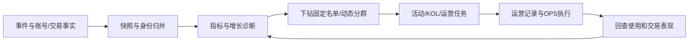

# 当前代码业务逻辑与审查（2026-10-21）

审查对象：当前工作区，包含上一轮尚未提交的性能回退。原审查仅记录问题；后续修复状态见下。
方法：追踪前后端入口、事实加载器、指标计算、任务状态机和写入边界；运行现有测试，并用隔离的内存数据库及模拟事实复现边界场景。没有读取生产凭据、连接生产数据库或执行 OPS 操作。本文不是逐行穷尽全部模块的正确性证明。

## 1. 三个已修复的问题

修复验证：后端313项测试全通过，包含新增的累计人数边界、滞后/未知观测进度、缓存淘汰/清空后的重新运行回归测试。未部署或修改生产数据。

- 追加成员在事务中按真实固定成员累计人数校验5000人上限，超限整笔不写入。
- 结算要求as_of及snapshot_cutoff有效且达到活动截止；查询成功但观测滞后的结果不会冻结。该检查仍不等于源系统完整采集水位保证。
- 完成任务只有在结果缓存仍存在时才复用；结果失效则重新排队。正常排队/运行中的任务继续合并。
- 没有自动删减历史超限名单，也没有改写历史已结算结果。

以下保留原问题分析与复现记录。

### P1：活动追加名单可超过计算上限，导致整个活动看板不可用

位置：`backend/src/routes/activityRoster.js:34–41`；`backend/src/data/memberMetrics.js:24–26`。

创建和单次追加都最多接受5000人，但追加只校验标签总量不超过50000，没有校验活动累计固定成员数。统计加载器则对整个活动名单执行5000人硬限制。

复现：创建5000人活动返回201；再追加1人返回201；读取该活动 metrics 返回422“相关账号超过5000人，请缩小范围”。名单已写入，页面分页不能解决，因为分页发生在全量计算之后。

建议：短期在追加事务内校验固定名单累计不超过5000，且使用真实成员表而非可独立修改的标签表计数。长期若支持更大活动，需要对事件、交易、账号事实分批加载并全局去重，也要处理历史活动及旧批次合并后超过上限的情况。

### P1：结算没有验证数据观测进度，可能永久冻结不完整结果

位置：`backend/src/routes/activities.js:32`。

结算只检查墙上时间超过截止24小时、查询未报错及活动版本未变。数据源仍在滞后时，成功返回的空/部分结果也能通过；保存 settled_result 后后续请求直接读取冻结值。

隔离复现：活动截止已过48小时，但快照 as_of 仍落后截止12小时；事实查询成功；结算返回200，并实际写入 settled_result。

建议：至少验证结果观测截至达到活动截止；事件及交易覆盖状态应单独记录。as_of 是最新观测事件时间，不是完整采集水位，因此仅补时间比较也不能证明完整性。没有完整水位时，应保留“暂定/观测结算”的明确状态和可审计重算路径，避免把等待24小时当成完整性保证。

### P2：完成任务的结果被缓存淘汰后，重新运行仍复用失效任务

位置：`backend/src/services/analysisJobs.js:11–14`。

任务元数据与结果缓存分别保存。元数据仍是 complete 时，start 不检查 job 结果是否还存在；但结果可能被共享缓存容量淘汰，或被系统清缓存删除。相同参数及同一快照会一直命中旧任务，随后 result 返回409“分析结果已过期，请重新运行”。

隔离复现：完成一个任务；删除其结果缓存；相同参数重新 start；返回相同 id、complete 状态；result 返回409。刷新快照或等待任务元数据过期可绕开，但直接重试不能恢复。

建议：仅复用有可读结果的 complete 任务；否则移除旧 key 并重新排队。queued/running 仍应合并，owner 隔离仍须保留。快照、任务元数据和下钻结果的过期也应协调，而不是各自延长。

## 2. 产品闭环

核心用途是让运营从“发生了什么”走到“找到哪些用户、做了什么、后续有没有表现变化”。

业务有两种用户身份：本系统登录的运营账号，和被分析的 Logearn 产品用户。owner_id/created_by 用于前者的数据隔离，user:账号ID 用于后者的事实关联，不能混用。

## 3. 数据层与一致性

- Hologres模式：远程事实用于分析；本地SQLite保存登录会话、活动、KOL、标签、人群配置、报告和任务等运营状态。
- SQLite模式：使用本地事件、用户事实及汇总表；并非远程模式的完整等价实现。部分运营能力明确要求远程模式。
- 远程路由优先拦截分析路径，未迁移能力返回501，不静默回退到本地旧数据。
- 事件由 eventsCte 统一筛选：按 event_id 去重；排除空ID、异常客户端时间及 acc_ 脏账号；有唯一用户映射时归并匿名身份；冲突匿名身份不强制归并。
- 统一分析键为 user:账号ID 或 anonymous:匿名ID；交易等旧账号事实另经验证的钱包映射关联。
- snapshot_cutoff 限制数据到达时间；as_of 是已接受事件的最新客户端时间。日期口径主要使用UTC+7，统计区间采用左闭右开。
- 当前快照不是数据库版本快照。源码已说明，源表后续更新/删除仍为弱一致；history_complete=false 不应被解释为已覆盖全部历史。

入口：`backend/src/index.js`、`backend/src/data/hologres.js`、`backend/src/data/userFacts.js`、`backend/src/data/pointsFacts.js`。

## 4. 分析指标业务定义

| 能力 | 实际业务含义 | 解读边界 |
| --- | --- | --- |
| 北极星 | 在期间内查看筹码分析或进行筹码下钻的去重用户 | 不是全部访问DAU；两个行为取并集 |
| 新增分析用户 | 首次已观测分析落在统计期内 | 不是注册新增；历史缺失会影响“首次” |
| 回访分析用户 | 期间有分析，首次分析早于统计期 | 与注册时间不同 |
| 增长诊断 | 本期与等时长上期拆成新增、重新活跃、持续活跃、未观测回访 | 未回访不等于已确认流失；维度拆分不能相加 |
| 漏斗 | 按关联模式及1/24/72小时窗口计算有序转化 | 不应把各步骤独立人数直接相除；pending与数据不全单列 |
| 留存 | 从首次已观测初始行为入组，按UTC+7自然日判断指定回访行为 | 支持7/14/30天；未成熟观察期不输出完整留存率 |
| 渠道质量 | 来源下的用户、分析、转化及成熟观察窗表现 | 来源是事件事实归因，不等于推广因果贡献 |
| 登录转化 | 登录尝试、阶段、结果及上下文关联 | 不把页面上有登录态直接当成新登录成功 |
| 邀请转化 | 邀请访问/验证/绑定事件与业务邀请关系、注册事实核验 | 埋点成功与真实关系成立分别核对；事实不可用不当作零 |
| 交易监控 | 提交/成功/失败埋点及关联质量 | 与业务交易表的真实成交额分开看 |
| 使用/交易表现 | 有效账号的分析事件、真实交易去重和已知金额 | 查询失败与金额缺失应保留未知状态及错误信息 |
| 路径/价值/流失诊断 | 页面访问、请求结果、功能路径及中断点 | 是已观测行为诊断，不自动证明因果 |
| 埋点验收 | 原始到达、被接受事件、关联ID与诊断版本的核验 | 按全平台或event_id核验，不接受来源/人群筛选 |

主要实现：`backend/src/workers/remoteAnalysis.js` 负责调度事实加载和纯计算模块；`backend/src/analytics/` 保存具体口径。

## 5. 分析请求与下钻

1. 前端获取meta，判断原始数据或聚合模式；大数据模式不下载全部事件。
2. 普通汇总直接查询；较重分析进入 analysisJobs。
3. 请求先验证时间、行为、来源及人群；静态群组验证归属，动态群组按已保存规则重算。
4. 以模式、参数、快照、人群和运营账号计算任务去重键；最多2个worker并行，队列20，任务30秒超时，结果4MiB上限。
5. 完成后保存指标和下钻名单；浏览器使用cache_id/list_key读取同一计算结果，避免重新计算后分子分母变化。
6. 从结果提取人群时固定名单和快照；保存报告使用服务端权威结果，不接受客户端上传的指标作为事实。

分析结果、快照和运行任务当前依赖进程内存。多实例负载均衡或重启不能天然共享这些状态；部署结构需要与此约束一致。

## 6. 人群、标签与运营任务

- 静态群组保存成员；动态群组保存规则，使用前重新计算，不能直接手改成员。
- 活动和KOL均可产生运营标签；标签支持交集/并集以及与已有范围叠加。
- 活动标签名单与活动固定参与名单分开维护。修改标签不会回写已冻结历史结果。
- 分群或增长诊断可生成运营任务，固定名单及基线表现，随后记录优先级、跟进、结果和复盘。
- 用户CRM另保存地址备注、人工权益台账和转化任务。人工权益记录不能直接当作源系统已发放成功。
- 更新任务等关键状态使用版本/updated_at校验，避免覆盖并发修改。

入口：`routes/cohorts.js`、`routes/operationTasks.js`、`services/userCrm.js`、`analytics/userTags.js`。

## 7. 活动生命周期

- 支持立即启动、预约及历史补录；参与者需匹配真实注册账号。
- 预约只保存计划名单；到期且数据观测达到开始时间后固定名单、基线与版本。源失败保持待启动，不冻结为零。
- 基线标记开始前已经分析的人；首激活转化以其余固定参与者为分母。迟到历史事实另记review，不悄悄改原分母。
- 追加成员进入同一个活动，并按原活动开始时间判断基线；这意味着是“统一活动期表现”，不是“加入名单后的增量”。需要按加入时间归因时应另做业务设计。
- 使用/交易表现覆盖全部参与者，包括原已分析用户；首激活与复访不是同一个指标。
- 截止后等待24小时才允许结算；结算结果永久落SQLite，之后读取冻结结果。这里存在第1节所列覆盖进度问题。

入口：`routes/activities.js`、`routes/activityScheduling.js`、`services/activitySchedule.js`、`analytics/activityMonitor.js`。

## 8. KOL、推广与OPS

- KOL本人账号、人工标签成员、有效直接邀请成员分别定义，不能混算成同一种贡献。
- 推广链接保存UTM及le_link；报告采用当前运营账号链接中的期间首次已观测触点，计算触点后的表现。
- OPS与本地台账不同，是真实调用上游接口。流程为参数规范化→预览→明确确认→顺序执行→逐行记录结果。
- 执行状态包含success/failed/unknown；超时、重启或响应不可判定不自动重试，避免重复发放。
- 效果复盘只纳入成功且核对过目标账号的相关发放，按批次结束时间比较等时长前后表现，最多7天；代码明确标注这不是因果增量。
- 平台资产在后台采集支持链及配置币种的关联钱包余额，完整批次才计入走势；估值还要求价格及链覆盖完整。不是全部资产、负债或DeFi仓位总账。

## 9. 权限与当前验证

检查到的主要约束：API使用Bearer会话；活动、KOL、人群、任务、报告和OPS按运营账号查归属；分析job按owner校验；OPS凭据独立保存且响应脱敏。全平台事实分析对登录运营账号可见，当前不是按团队/角色划分的业务数据权限体系。

复现只使用临时进程、内存SQLite和模拟查询；未修改现有业务代码。现有测试全通过并不能覆盖第1节的跨模块边界。

本轮重跑：后端310项通过、0失败；前端253项通过、4项跳过。未执行生产环境端到端验证。
