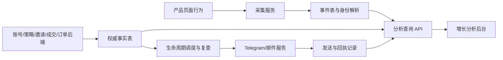

# LogEarn 增长分析：设计评估、埋点与数据接口

版本：1.3 · 核对日期：2026-10-06（Asia/Bangkok）

面向产品、产品前端、分析前端、后端及数据团队。依据当前仓库实现核对，不将Mock演示、接口客户端或执行适配器视为已上线服务。本文同步已实现的渠道管理与待接入的产品采集、服务端归因和聚合契约。

**最新实现：默认页面100%读取 mock-api JSON；已移除内置用户生成、合成交易、渠道比例及分析成交推算。未提供的数据模块不展示。生命周期只分析，当前不需要第16节列出的三个生命周期接口。**

**后端开发入口：[第16节：后端 API 交付清单](#16-后端-api-交付清单)**。前端事件接入见第15.1节；生命周期状态与候选由 Dashboard 计算，后端提供事实和发送服务。

## 1. 整体评估与上线边界

**结论：分析设计已形成可用框架，下一步应先补数据事实与口径，再启用真实渠道、归因和触达服务。**

目前以有效分析为核心，串起来源、漏斗、路径、留存、用户状态、推荐及运营动作。通用人群对比减少了重复仪表盘；成熟观察窗口、未知状态与缺失接口已在多处区别展示。设计上需要继续统一日期、来源和人群范围，并明确“相关比较”与“归因”的区别。

| 功能 | 已实现设计与计算 | 真实数据条件 / 缺口 |
|---|---|---|
| 北极星指标 | 每日有效分析用户DAA、首次/回访、用户下钻、交易贡献 | events/users可接；首次识别仍依赖载入历史；平台交易贡献另需全量trades |
| 独立漏斗 | 整体分析、AI及自定义，时间窗、流失/待观察 | 用户事件顺序匹配；不限制同Token/会话，不代表单币转化 |
| 行为路径 | 四模块、Token点击、详情、AI、结果与分享事件，桑基图、路径排名 | 按session_id，否则30分钟推断；A→B→A→C保留；连续重复合并；交易上下文尚丢失 |
| 留存 | D1–D7日/连续留存、成熟状态、批次下钻 | 初次行为需可靠历史；统一UTC+7业务日 |
| 推荐与增长循环 | 三类分享、点击/完成/访问、绑定/激活、K与链接排行 | events/referrals可接；关系来自后端正式绑定，不能从点击推断 |
| 用户分群 | 互斥行为分群、邀请/交易/绑定/语言标签 | users无行为账号已合并；绑定/语言为当前状态 |
| 人群对比 | 多条件筛选、单维度分组，概览/漏斗/留存/趋势，人数下钻 | 当前属性回看；绑定/行为分群不开放留存比较；缺入组属性快照 |
| 生命周期触达 | 六类规则、渠道选择、候选/频控、模拟记录，服务端接口客户端和worker适配器 | 真实调度、原子预约、发送供应商、内容模板、回执尚需后端提供 |
| 渠道分析 | 渠道管理、六字段匹配、启停、版本快照、未知渠道兜底及演示报表 | 真实配置接口客户端已提供；配置服务、产品采集、历史归因和报表聚合尚需接入 |
| 价值闭环 | 分析后1h/24h成交与AI贡献演示 | 真实模式整页待获取；需交易到分析的关联，当前加trades也不会自动启用 |

### 需要调整/统一的设计

1. **三个日期口径分开显示**：周期表现按发生日期；留存按首次行为入组日期；分群/触达按截至状态。人群对比有独立日期和来源，不能让用户误以为侧栏条件已同步作用。
2. **来源名称统一**：用户首次获客来源、首次有效分析来源、站内入口是三个字段。现有各页来源分母不完全一致，需要保留具体标题，不能统称“来源”。
3. **当前属性不是历史属性**：当前语言/绑定用于现况人群；留存语言比较目前是“按当前语言回看同日批次”。后续固定入组语言/绑定后再做历史比较。
4. **推荐不画伪漏斗**：分享者与访问/绑定者不是同一个用户。当前阶段各自计数，严格跨身份漏斗应按链接/分享批次入组，而不是相除不同周期总数。
5. **行为分群比较存在定义关联**：高频核心的有效分析高是定义的一部分，不能用它证明运营效果。
6. **统一待观察与数据能力状态**：成功返回空数组=真实零记录；接口未提供/采集未启用=不可计算；观察窗口未结束=待观察。
7. **图表保留分母与下钻**：漏斗起点归一化便于比较规模不同的人群，同时显示人数；留存显示成熟分母；趋势显示每日用户池。
8. **Mock一致性待改善**：现有Mock交易贡献/对比来自日汇总模拟，交易标签来自trade事件，两者不一致。生产必须由同一逐笔事实推导；演示数据不用于评估真实转化。

## 2. 数据链路与团队职责



| 工作 | 负责方 | 当前仓库支持 |
|---|---|---|
| 正确触发行为、路由上下文、队列重试 | 产品前端 | 提供SDK，真实产品页面不在此仓库 |
| 采集入库、幂等、身份解析、数据水位 | 后端/数据 | 尚无服务实现 |
| 账号绑定、语言、订阅、邀请关系、成交等事实 | 业务后端 | 分析适配器已消费其中部分字段 |
| 查询API、数据校验、图表和下钻 | 数据后端 + 分析前端 | 已有4类查询及生命周期客户端 |
| 定时任务、频控、模板、实际发送和回执 | 服务端运营/消息系统 | worker模板可复用，未部署供应商服务 |

**不要求接GA4、GTM或其他新平台**；现有自有采集服务可以对接。外部平台只作为可选去向，不替代账号、交易和邀请权威事实。

## 3. 标识、时间与归因的基础规则

- 全部API用户ID使用原始字符串，例如`u-1001`；前端内部会加`user:`。不要在业务接口预先加此前缀。
- `event_id`全局唯一，重试保持原ID；后端与前端均应幂等去重。
- `anonymous_id`对应未登录访客；登录关联事件同时带anonymous_id和user_id。生产在后端解析身份，防止窗口外登录断链及同设备换账号错合并。
- `session_id`标记一次会话，30分钟无操作切换；当前SDK用sessionStorage，仅覆盖同标签页，不代表跨设备身份。
- `token_visit_id`标记一次Token访问链，点击→详情→策略→筹码峰继承；返回或开启新的Token访问生成新ID。
- `strategy_run_id`标记一次实际策略运行；`result_id`标记该次生成的结果。启动、生成、查看须能精确关联。
- `referral_link_id`由后端签发，绑定唯一邀请人和分享类型；前端不能任意声明邀请人归属。
- 时间使用带时区ISO8601，建议UTC；业务日固定Asia/Bangkok（UTC+7），查询范围`[start,end)`。同毫秒步骤排序如需可靠支持，应增加sequence并修改现有严格时间比较。
- 事件归属：访问分享链接的actor是接收者，properties.inviter_user_id才是邀请人。

### 来源与语言字段

| 字段 | 含义 | 当前消费状态 |
|---|---|---|
| users.first_source | 用户首次外部获客来源 | 已读取；来源筛选主要枚举SEO/直接访问/Bot/社群/邀请/KOL/合作 |
| events.first_entry_source | 现有事件适配字段，转内部entry_source；首次有效分析/首次所选行为取该事件值分组 | 已读取；命名容易误解，需双方按对应首次行为来源事实填充，不要直接复制用户获客来源 |
| properties.entry_module | 站内进入Token/分析的模块 | 已读取；callouts/signals/popular/fomo |
| users.first_analysis_entry_module | 历史首次有效分析站内入口 | 已读取；需后端固定，不随近期访问改写 |
| users.preferred_language | 用户当前选择的产品语言 | 已读取，zh系列/en系列归组，其他或缺失单列 |
| properties.language_at_event | 事件发生时语言快照 | 建议新增；当前归一化不保留 |
| users.first_analysis_at / first_analysis_source | 历史首次有效分析时间/来源 | 建议新增；当前计算尚未使用 |

当前接口兼容字段不要随意改名；若统一为更清楚的event entry_source/first_analysis_source，需同步修改适配器和指标计算，并验证历史数据。

## 4. 必须埋的事件：当前SDK/适配器支持

P0为首轮必接，P1为策略结果/增长与触达阶段接入。每条事件都有第5节公共字段。

| 优先级 | event_name | 触发条件 | 业务properties | 建议采集责任 | 支撑功能 |
|---|---|---|---|---|---|
| P0 | login_succeeded | 登录确实成功 | 登录用户/匿名ID关联；来源 | 认证后端确认后产品端记录，避免双发 | 漏斗、未分析触达 |
| P0 | module_viewed | 模块内容真实呈现；进入/切换一次，非轮询 | module | 产品前端 | 喊单/信号榜单/热门/FOMO路径 |
| P0 | token_opened | 用户点击模块内Token | entry_module、token_address、chain、token_visit_id；item_id/position建议提供 | 产品前端 | 点击到详情损失、入口路径 |
| P0 | token_detail_viewed | 详情数据加载成功并呈现 | Token链上下文 | 产品前端 | 分析/AI漏斗 |
| P0 | strategy_started | 策略实际启动成功，非点击启动按钮 | strategy_type、strategy_run_id、Token链上下文 | 策略服务确认后记录 | AI漏斗、策略分群 |
| P0 | chip_analysis_viewed | 用户成功看到筹码峰；缓存也可算，预加载/轮询不算 | Token链上下文；建议analysis_id | 产品前端在呈现成功时记录 | DAA、分析留存、分群、触达目标 |
| P1 | strategy_result_generated | 本次策略结果可供查看 | strategy_run_id、result_id；Token上下文 | 策略后端事实 | 未查看信号提醒 |
| P1 | strategy_signal_viewed | 用户真实打开该运行的结果 | strategy_run_id、result_id；Token上下文 | 产品前端 | 结果消费、取消提醒 |
| P1 | share_button_clicked | 点击主动邀请、信号或倍数分享入口 | referral_link_id、inviter_user_id、share_type；content_id、share_method | 产品前端 | 分享入口使用率 |
| P1 | share_completed | 复制成功、卡片交付/分享功能返回成功；不是对方收到 | 与点击相同的链接/功能/内容 | 产品前端 | 完成分享与功能对比 |
| P1 | invite_link_visited | 邀请链接接收者有效落地 | referral_link_id、inviter_user_id、share_type | 落地页+后端校验 | 访问UV、链接排行 |

模块枚举：`callouts=喊单`，`signals=信号榜单`，`popular=热门`，`fomo=FOMO热门`。

分享类型：`invite=主动邀请按钮`，`signal=信号分享`，`multiplier=倍数分享`。content_id标记分享的信号/倍数内容；分享类型不能只由按钮文案推断。

### 触发与防重复

- 点击详情和详情成功呈现是两条事件；详情失败不能记成功。
- 筹码峰成功呈现同一analysis_id的一次用户展示记一次；再次主动分析/打开新的展示可以记新事件，后台自动更新不记。
- 启动/结果生成以业务成功事实为准，不在前端点击时提前记。
- 如果前端和后端都发送同一成功事实，应指定唯一所有者，或共用event_id；否则前端去重无法识别不同ID的重复事实。
- 分享取消、复制失败不记share_completed。倍数卡片生成但未交付用户不算完成分享。
- 链接落地记录访问者身份；UV按统一身份去重，功能表按链接UV累计，不能与顶部全局UV相加等同。
- SDK发送失败由产品采集队列重试，不能阻断导航；同一事件重试不重新生成event_id。

## 5. 公共事件格式与样例

```json
{
  "event_id": "evt-1001",
  "event_name": "chip_analysis_viewed",
  "occurred_at": "2026-10-05T02:01:00.000Z",
  "user_id": "u-1001",
  "anonymous_id": "anon-1001",
  "session_id": "session-1001",
  "first_entry_source": "SEO",
  "properties": {
    "entry_module": "signals",
    "token_address": "token-address",
    "chain": "solana",
    "token_visit_id": "visit-1001",
    "strategy_type": "1.5段",
    "strategy_run_id": "run-1001",
    "result_id": "result-1001"
  }
}
```

| 字段 | 类型 | 要求 |
|---|---|---|
| event_id | string | 必填，唯一；重试保持 |
| event_name | string | 必填，使用事件白名单 |
| occurred_at | ISO string | 必填；服务端验证有效时间与未来漂移 |
| user_id / anonymous_id | string/null | 至少一个；登录关联携带两者 |
| session_id | string | 产品行为必备；后端系统生成结果不应伪造会话，可为null |
| first_entry_source | string/null | 使用历史来源事实；无法识别标未知 |
| properties | object | 事件业务字段，成功事件必须带关联ID |

当前也支持client_ts毫秒并优先于occurred_at，建议接口统一用occurred_at，避免冲突和客户端时钟导致偏差。分析ID/事件语言等扩展即使回传，当前代码也尚未消费，应按实施清单修改。

## 6. 不应只靠埋点获得的业务事实

| 数据 | 权威来源 | 必需字段 | 用途 |
|---|---|---|---|
| 用户账号 | 用户服务 | user_id、created_at、first_source、preferred_language | 用户池、语言/来源维度 |
| 绑定状态 | 账号绑定服务 | telegram_bound、email_bound | 当前绑定标签，解绑后false；邮箱验证成功才true |
| 历史首次 | 数据/用户事实表 | first_analysis_at、first_analysis_source、首行为事实、覆盖状态 | 首次/回访与留存，需改前端消费 |
| 属性历史 | 用户属性变更事实 | user_id、effective_at、语言/绑定/偏好变化 | 入组快照；当前无历史对比适配 |
| 推荐绑定 | 推荐关系服务 | inviter_user_id、invitee_user_id、bound_at、referral_link_id、share_type | K与邀请链接排行 |
| 邀请链接 | 推荐链接服务 | 链接ID、归属邀请人、分享类型、内容ID、创建时间 | 防止客户端伪造归因 |
| 逐笔成交 | 成交后端/确认服务 | trade_id、user_id、confirmed_at、volume_usd、status | 全平台交易贡献/交易标签 |
| 交易到分析关联 | 归因服务 | analysis_event_id、Token/会话上下文、策略事件ID | 价值闭环；需改前端消费 |
| 成功订单/订阅 | 订单后端 | order_id、user_id、paid_at、amount、currency、status | 付费用户；交易成功不等于付费 |
| 发送与回执 | 消息服务 | delivery_id、rule_id、user_id、channel、状态、时间、模板语言、provider_id | 触达记录/频控/结果 |

账号绑定、语言、正式邀请关系和成交应取后端事实；可另采变化事件用于审计历史，不从点击“绑定/交易”猜测成功。

## 7. 已有分析读取API：后端可以按此对接

默认根路径`/api/analytics`。事件、用户为必需；推荐、交易可独立缺失。当前没有cursor追读，初期必须返回完整数组，不得静默分页截断。

### 7.1 GET /events?start=<ISO>&end=<ISO>

```json
{ "events": [ { "event_id": "evt-1", "event_name": "module_viewed", "occurred_at": "2026-10-05T02:00:00Z", "user_id": "u-1001", "anonymous_id": "anon-1001", "session_id": "session-1001", "first_entry_source": "SEO", "properties": { "module": "signals" } } ] }
```

保持事件名称、时间和业务上下文完整。后端先处理统一身份；前端按event_id去重。未知事件当前被忽略。启动请求最近90天，返回meta不会自动修正前端数据水位。

### 7.2 GET /users

```json
{
  "users": [
    {
      "user_id": "u-1001",
      "created_at": "2026-09-01T03:00:00Z",
      "first_source": "SEO",
      "preferred_language": "en",
      "first_analysis_entry_module": "signals",
      "telegram_bound": true,
      "email_bound": false
    }
  ]
}
```


### 7.3 GET /referrals

```json
{
  "referrals": [
    { "inviter_user_id": "u-1000", "invitee_user_id": "u-1001", "bound_at": "2026-10-01T03:00:00Z", "referral_link_id": "link-1000-signal-42", "share_type": "signal" }
  ]
}
```

当前按被邀请人首次绑定去重、排除自邀，绑定后7天内有效分析计激活。绑定期是入组窗口，后续分析可跨统计期至asOf。K=激活被邀请人/至少绑定一人的推荐者，不含只分享而没人绑定的人作为推荐者分母。无链接ID的绑定列入未归因。后端提供经过业务校验的正式关系，不能重复改写邀请者。

### 7.4 GET /trades?start=<ISO>&end=<ISO>

```json
{
  "trades": [
    { "trade_id": "trade-1001", "user_id": "u-1001", "confirmed_at": "2026-10-05T02:05:00Z", "volume_usd": 125.5, "status": "confirmed" }
  ]
}
```

金额为非负JSON number，USD成交额而非手续费。必须返回全平台成交，不仅分析用户成交；trade_id后端去重，当前前端交易未去重。status=confirmed才计入。当前交易归一化只保留以上五字段，即使增加上下文也需修改适配器才能用于路径/归因。

## 8. 采集与业务接口：建议新增，当前没有这些服务

### 8.1 POST /collect（或复用现有采集服务）

请求`{"events":[<第5节事件>]}`；成功建议`{"accepted_event_ids":["evt-1001"]}`，部分失败另列rejected_event_ids及原因。服务端以event_id幂等，认证身份不能仅相信浏览器传来的user_id。

当前SDK仅接收send(event)函数，不含POST、持久化离线队列或产品页面自动绑定。调用方在send里接现有采集队列，不把失败吞成成功。

### 8.2 邀请链接创建服务

建议`POST /referral-links`：

```json
{ "share_type": "signal", "content_id": "signal-42", "entry_module": "signals" }
```

返回：

```json
{ "referral_link_id": "link-1001-signal-42", "inviter_user_id": "u-1001", "share_type": "signal", "url": "https://YOUR_PRODUCT_DOMAIN/invite?code=SIGNED_CODE" }
```

域名是部署占位符，不是已存在地址。邀请人由服务端认证确定；落地校验服务解析code得到归属，客户端不能修改签名参数。绑定关系仍由用户业务流程正式写入。此接口是依赖建议，尚未加入当前SDK自动调用。

### 8.3 价值闭环：扩充交易读取数据

在第7.4节成交字段外增加：

```json
{
  "session_id": "session-1001",
  "chain": "solana",
  "token_address": "token-address",
  "token_visit_id": "visit-1001",
  "analysis_event_id": "evt-1001",
  "strategy_event_id": "evt-strategy-1"
}
```

一笔成交只能归属一个分析。优先显式analysis_event_id；没有时可采用“同用户+同链+同Token+交易前最近一次分析”的推断规则并标记。AI贡献依赖该分析关联策略，不能只看用户曾用AI。1h/24h窗口未满的分析单列待观察。

**需同时改normalize与真实价值闭环页面计算**；只加接口字段不会启用当前真实页。

### 8.4 渠道查询（建议契约，前端未读取）

建议`GET /channel-stats?start=...&end=...`返回：

```json
{
  "meta": { "timezone": "Asia/Bangkok", "attribution": "first_acquisition_source", "count_unit": "unique_users" },
  "channels": [
    { "source": "SEO", "visit_users": 1000, "login_users": 450, "analysis_users": 300, "d7_eligible_users": 200, "d7_retained_users": 60, "trade_users": 70, "paid_users": 20, "volume_usd": 35000 }
  ]
}
```

访问/登录/分析/交易/付费以本期到访人群为统一池统计；D7以其中本期首次分析且完整观察D7者为分母，另显示eligible。全站访问需page_viewed或后端访问事实，四模块浏览不是全站访问。订单成功事实用于paid_users。

汇总不能直接实现用户下钻；后续`GET /channel-users?source=...&metric=analysis_users&start=...&end=...&cursor=...`返回`{"users":[{"user_id":"u-1001"}],"next_cursor":null}`，复用聚合口径。当前代码没有此聚合/下钻适配。

## 9. 生命周期接口：已有客户端，服务端尚需实现

### 9.1 GET /lifecycle?source=all

返回完整六条规则和发送事实，Dashboard 自行计算生命周期、候选、频控预估及目标结果。deliveries_complete=true 表示至少覆盖当前人群近7天、跨全部来源和渠道的完整频控记录，包括 queued/unknown；不能仅按发送来源裁剪。示例：

```json
{
  "deliveries_complete": true,
  "rules": [
    { "id": "first_analysis", "enabled": true, "channel": "auto" },
    { "id": "first_strategy", "enabled": true, "channel": "auto" },
    { "id": "view_signal", "enabled": true, "channel": "telegram" },
    { "id": "inactive_3d", "enabled": true, "channel": "auto" },
    { "id": "core", "enabled": true, "channel": "auto" },
    { "id": "churned", "enabled": true, "channel": "email" }
  ],
  "deliveries": [
    { "id": "delivery-001", "user_id": "u-1001", "rule_id": "view_signal", "channel": "telegram", "sent_at": "2026-10-05T02:00:00Z", "status": "sent", "strategy_run_id": "run-1001", "result_id": "result-1001" }
  ]
}
```

channel枚举auto/telegram/email。前端验证完整六条规则、有效记录时间和 deliveries_complete=true；缺失或格式失败仍可查看本地候选，但禁止提交真实触达。规则修改后需要先保存并重新读取，发送前服务端复查。

### 9.2 PUT /lifecycle/rules

请求`{"rules":[{"id":"first_analysis","enabled":true,"channel":"auto"}, ...六条]}`；响应`{"saved":true}`。服务端验证ID/渠道、权限并持久化。

### 9.3 POST /lifecycle/dispatch

请求`{"requests":[{"user_id":"u-1001","rule_id":"view_signal","channel":"telegram","strategy_run_id":"run-1001","result_id":"result-1001"}],"as_of":"2026-10-06T09:00:00Z","idempotency_key":"unique-request-id"}`；响应`{"batch_id":"batch-001"}`。requests 来自 Dashboard evaluateLifecycle 的 eligible 行，user_id 使用原始业务 ID。受理不等于送达；刷新读取实际记录。

不需要服务端预览或 preview_id。服务端校验操作权限、已保存规则、允许的用户范围及 as_of 新鲜度；发送前复查最新目标、绑定、订阅和频控，原子预约后调用发送供应商。只允许处理请求中的用户，不扩大人群。同幂等键不得重复发送；跨批次仍通过用户频控保护。客户端提交后锁定执行直至重新读取记录；超时先核对记录，不能盲目重发。

### 9.4 当前规则及执行条件

| rule_id | 条件 | 目标行为 | 优先级 |
|---|---|---|---:|
| view_signal | 同run结果生成满30分钟且未查看 | 对应strategy_signal_viewed | 1 |
| first_analysis | 首次登录满30分钟且从未有效分析 | chip_analysis_viewed | 2 |
| first_strategy | 首次分析满24h、近3天分析且从未启动策略 | strategy_started | 3 |
| inactive_3d | 最后分析距今3至28天 | chip_analysis_viewed | 4 |
| core | 28天≥6分析日且近3天活跃 | share_completed | 5 |
| churned | 最后分析距今超过28天 | chip_analysis_viewed | 6 |

每人24h最多一次，同场景7天冷却，多场景选择最高优先级的可用场景。已绑定且明确订阅才发送；auto优先Telegram，后邮箱。绑定/语言未知不能猜测联系人和模板。

worker适配器`loadState/reserve/send/record`需接后端数据库与消息供应商。reserve必须原子保护跨worker、跨渠道频控，并写queued记录；供应商发送也使用幂等key。超时可能已经发送，当前worker标unknown占用频控；不得直接重试造成重复发送。供应商确认成功后的落库失败不能把已发送改为失败。

当前目标统计是发送后24h目标行为的关联结果，不是因果提升；新目标发生才计入，未满窗口待观察。高级活动实际参与、送达、点击和退订指标还需第10节扩展。

## 10. 下一阶段补充事件（当前SDK/适配器不支持）

以下不是已接入事件，加入前必须改事件白名单、归一化与查询/图表。能由后端事实可靠提供的项，可不另走浏览器埋点。

| 建议事件/事实 | 属性 | 目的 | 优先级 |
|---|---|---|---|
| page_viewed / 全站到访事实 | page_key、脱敏路由、进入来源/UTM、匿名ID、语言 | 渠道访问分母、完整页面路径 | P1 |
| signup_completed / 注册事实 | user_id、created_at、注册来源 | 未使用注册用户与批次 | P1；用户表已能覆盖人数 |
| user_language_changed / 属性历史 | old_language、new_language、effective_at | 入组语言固定 | P1 |
| account_binding_changed / 绑定历史 | provider、bound、effective_at | 入组绑定状态与解绑审计 | P1 |
| payment_completed / 成功订单事实 | order_id、paid_at、amount、currency、status | 渠道付费 | P1 |
| message_delivered / failed / clicked | delivery_id、provider_id、状态/点击时间 | 触达送达与访问 | P1；后端回执为准 |
| advanced_campaign_joined | campaign_id、delivery_id | 核心用户活动参与目标 | P2；当前核心目标仍是分享完成 |

通知点击到业务页面可传delivery_id；分析/策略事件携带delivery_id作为显式触达关联。当前只按发送时间窗观察，尚未消费这一归因字段。

## 11. 上线前需要修复的数据层缺口

| 优先级 | 缺口 | 影响与处理 |
|---|---|---|
| P0 | 90天截断首次历史 | 错判首次、回访、老用户、未分析触达；后端提供权威首次/历史摘要并改前端消费 |
| P0 | 窗口内身份映射且匿名ID可跨账号 | 漏斗/留存/UV拆分或错合并；服务端解析正式身份，按时间处理账号切换 |
| P0 | asOf取浏览器当前时间 | 数据延迟被误判未转化/未回访；接口统一水位并改启动逻辑 |
| P0 | 基础事件/交易验证不完整 | 非法时间/金额、重复成交影响指标；后端校验去重，前端补验证 |
| P0 | 缺分页与完整性 | 大数组静默截断会低估；改cursor追读或服务端聚合+下钻 |
| P0 | 真实消息服务未部署 | 前端与worker不能代替调度；部署服务并验频控/幂等/复查 |
| P1 | 交易丢失session/Token/分析关联 | 路径交易会分错会话，价值页无法用；normalize保留上下文 |
| P1 | 当前属性历史不足 | 语言改动影响历史组别，绑定/分群不能用于留存；补属性历史/入组快照 |
| P1 | 渠道/价值闭环真实模式禁用 | 补事实和页面适配后启用；不要填演示比例作为真实结果 |
| P1 | 未知来源呈现不一致 | 部分页面固定枚举，未知/新来源未完整展示；统一动态枚举与未知组 |
| P1 | 能力缺失与真实零事件 | 分享当前无事件即待采集；需能力标识区分已启用但0事件 |
| P1 | Mock交易两套来源 | 同页标签和对比人数不一致；统一Mock逐笔事实 |
| P2 | 查询与聚合重复计算 | 浏览器处理大历史成本高；将稳定口径迁到后端，保留可复现下钻 |

SDK参数校验只覆盖部分事件属性，不代表数据全部合规。当前用户池合并无行为注册账号已完成，不再作为未解决项。

## 12. 统一响应元信息、鉴权和缺失状态（建议扩展）

建议四类查询共用：

```json
{
  "meta": {
    "schema_version": "1.1",
    "timezone": "Asia/Bangkok",
    "coverage_start_at": "2026-01-01T00:00:00Z",
    "data_as_of": "2026-10-06T02:00:00Z",
    "history_complete": false,
    "snapshot_id": "snapshot-20261006-0200",
    "capabilities": { "sharing": true, "trades": true, "payments": false }
  },
  "events": [],
  "next_cursor": null
}
```

此meta/cursor是目标契约：当前客户端不消费meta、不追分页，必须实施后才能生效。多接口使用同一snapshot_id/watermark，避免用户与事件来自不同时刻。

成功空数组只表示真实零记录。缺接口/未启用不返回伪造0；失败返回非2xx。当前事件/用户失败阻止分析初始化，推荐/交易失败可分别降级。启动失败不回退Mock。

当前fetch适合同源请求，没有Bearer注入、跨域带cookie或Vite代理配置。后端提供实际鉴权方式后再改客户端；管理API密钥/Telegram Bot Token/邮件凭据留服务端，不放VITE变量。采集不需要传实际邮箱、Telegram联系人、钱包私钥或含凭证的URL。

## 13. 联调验收：按真实行为验证，不只看图有数字

| 场景 | 操作 | 通过条件 |
|---|---|---|
| 匿名→登录 | 模块浏览→登录→详情→筹码峰 | 一个正式用户，匿名事件保留，DAA只计一次 |
| 四入口 | 从喊单/信号/热门/FOMO各进入 | module和entry_module正确，同visit链完整 |
| 返回路径 | A→B→A→C | 返回A保留，不形成桑基图循环 |
| 失败/轮询 | 详情加载失败、筹码峰预加载/刷新 | 不记成功展示，不膨胀DAA |
| 事件重试 | 重发同event_id | 一条事件；成功事实跨端也不重复 |
| 漏斗 | 起点期内，后续跨日期在窗口内；另一人窗口未满 | 正常转化、待观察单列、点击梯形下钻人数一致 |
| 留存 | 同D0中/英组，第7日尚未完成 | 相同入组日期，未成熟显示—而不是未留存 |
| 绑定/语言 | true/false/null、解绑、切换语言 | 未知不当false，当前属性变化正确，缺历史比较被限制 |
| 用户池 | 注册但无行为用户 | 出现在未激活/绑定/语言池；注册在周期结束后不进该期对比 |
| 分享三类 | 点击、取消；复制成功；接收者访问 | 点击≠完成，访问actor为接收者，链接ID及功能不丢失 |
| 推荐关系 | 重复绑定、自邀、未满7天 | 首次关系去重、自邀排除、激活/待观察一致 |
| 交易 | 重复成交、失败订单、非分析用户成交 | 去重confirmed，全平台总量正确，交易不冒充付费 |
| 触达资格 | 绑定但未订阅；发送前用户已完成目标 | 不发送；复查后取消 |
| 触达幂等 | 重复预览提交、双worker、供应商超时 | 每人频控有效，不重复发送，unknown不直接重试 |
| 数据缺失 | 交易接口失败、sharing能力关闭、延迟入库 | 待获取/未启用/水位明确，不伪装0 |
| 人群对比 | 英文+Telegram绑定，按来源分组 | 表格、漏斗、趋势和下钻使用同一池；留存限制说明可见 |

本次文档核对时运行现有测试：61项通过；此前最新构建通过。测试验证本地规则，不证明生产埋点、后端接口或消息供应商已联调。

## 14. 推荐实施顺序与交付物

### 第一批：可相信的分析基础

产品端接11个已支持事件中的P0项；后端接events/users，统一身份、去重、首次事实和水位。产品/数据确认来源与业务日。交付：原始事件样例、字段校验、首次/回访核对SQL或查询、数据覆盖说明。

### 第二批：增长与人群

接结果生成/查看、三类分享事件、推荐链接与绑定关系；补语言/绑定/订阅。接trades并统一成交事实。交付：真实链接全链路、推荐K核对、人群对比与交易量核对。

### 第三批：真实自动触达

部署三类生命周期API、原子预约和定时worker，接Telegram/邮件模板、订阅复查、语言选择、回执。先内部测试账号验证各场景，再启用业务人群。交付：调度状态、发送幂等、频控与取消演练、记录与目标观察。

### 第四批：完整渠道与价值闭环

补全站访问、订单、属性历史和交易到分析关联，启用真实渠道/价值页；量大时迁移服务端聚合与人群分页。交付：统一分母、归因规则及同口径下钻。

联调需后端提供：实际API地址、鉴权方式、测试环境、完整响应样例、数据覆盖/水位、来源与策略枚举、联系人发送服务状态。当前仓库没有这些外部服务配置，不能仅开启API模式就认定上线。

## 15. 代码定位与维护

- 事件白名单：`src/analytics/events.js`
- 产品采集SDK：`src/tracking/client.js`
- 查询客户端/归一化：`src/api/analytics.js`、`src/analytics/normalize.js`
- 主页面与真实模式限制：`src/dashboard.js`、`src/main.js`
- 推荐/分享：`src/analytics/referral.js`、`src/analytics/sharing.js`
- 人群与视图：`src/analytics/comparison.js`、`comparisonViews.js`、`src/comparison/`
- 生命周期：`src/lifecycle/rules.js`、`api.js`、`panel.js`、`worker.js`

本文件为当前统一交付文档；较早的`API_DATA_CONTRACT.md`包含迭代记录和详细旧样例。发生冲突时先以实际代码与本文件的“已支持/建议扩展”边界核对，再同步更新两份文档。

## 15. 渠道管理实施清单

渠道页支持新增、编辑、停用、启用、显示停用渠道及匹配示例。六字段精确匹配，条件为 AND；空字段不限制。优先级数字越小越优先，同值按 channel ID 排序，一次访问最多一个渠道，无匹配为系统「未知渠道」（channel_id=unknown）。平台币安广场使用 `binance_square`。

演示模式用 localStorage 保存配置和版本历史。原有合成渠道报表尚未使用新配置，不会伪造新增渠道的访问数据。真实模式需要：

- `GET /api/analytics/channels` → `{rules:[{id,name,conditions,priority,enabled,version,updated_at}]}`。
- `PUT /api/analytics/channels` ← `{channel:{id,name,conditions,priority,enabled,version,updated_at},expected_version}`；成功返回 JSON。服务端需检查管理员权限、字段合法性与版本冲突；新增 expected_version=0，已有版本不匹配返回409。
- 保存更新应由服务端原子地生成新版本、保留旧版本，返回权威配置。当前客户端在成功后采用提交版本，服务端需要遵循该协议。
- 访问接收时记录六个原始字段及 `channel_id/channel_version/channel_name` 归因快照。停用、编辑只影响后续访问，历史分析按快照统计；改名后的历史展示可通过稳定 ID 查询当前名称。
- 历史重算未实现。归因计算函数已提供，真实访问采集及聚合服务仍需接入。

渠道管理优化：增加名称/条件搜索、启用及停用数量、按优先级排序、中文字段说明和填写示例。系统兜底渠道固定 `channel_id=unknown`、名称「未知渠道」、版本1，不能编辑或停用，不作为普通规则参与匹配。全部启用规则均未匹配时（包括来源参数缺失）归入该渠道；不自动归入直接访问。旧的历史未归类快照保持原值，服务端展示时可映射到未知渠道，不自动重写历史。当前报表仍需接入渠道快照聚合数据。

### 15.1 产品前端必须打点的事件

本清单面向真正的产品网站，而非分析后台。后台新增/编辑渠道是配置操作，不能代替用户访问事件。标注「已支持」表示 SDK/归一化识别事件名称，不代表产品页面已接好；本仓库不包含实际产品页面。

所有事件必传：`event_id`、`event_name`、`occurred_at`（UTC ISO）、`anonymous_id`、`session_id`；已登录时传 `user_id`，未登录为 null。重试保持 event_id 不变。内部行为持续携带当前访问的 `visit_id`（新增待接入），供服务端关联入口归因。

| 优先级 | 前端事件 | 触发时机（每次成功事实只发一次） | properties 必传字段 | 当前支持状态 |
|---|---|---|---|---|
| P0 | `page_viewed` | 外部进入页面、刷新、SPA 路由成功展示；排除组件重渲染 | `visit_id`, `page_key`, `landing_path`, `is_entry`, 六个来源字段, `referrer_host` | **需新增 SDK 白名单、归一化和产品接入** |
| P0 | `login_succeeded` | 登录/鉴权成功，已取得真实 user_id 后 | `visit_id`；事件顶层同时保留 anonymous_id 与 user_id | 已支持名称，visit_id 需补适配 |
| P0 | `token_detail_viewed` | Token 详情成功展示 | `visit_id`, `token_visit_id`, `token_address`, `chain`, `entry_module`（外部直达可为 null） | 已支持名称，visit_id 需补适配 |
| P0 | `chip_analysis_viewed` | 成功结果已展示给用户；不是按钮点击或请求发起 | `visit_id`, `token_visit_id`, `token_address`, `chain`, `analysis_event_id`（成功分析稳定ID，新增）, `entry_module` | 已支持名称，visit_id/analysis_event_id 需补适配 |
| P0 | `strategy_started` | 服务端确认策略创建/启动成功 | `visit_id`, `strategy_run_id`, `strategy_type`, `token_address`, `chain`, `token_visit_id` | 已支持名称，需产品按服务端成功结果触发 |
| P1 | `module_viewed` | 喊单、信号榜单、热门、FOMO 模块实际展示 | `visit_id`, `module`：callouts/signals/popular/fomo | 已支持名称 |
| P1 | `token_opened` | 点击模块内 Token 跳转入口 | `visit_id`, `module`, `token_address`, `chain`, `token_visit_id`；建议 item_id/position | 已支持名称 |
| P1 | `share_button_clicked` | 点击主动邀请、分享信号或分享倍数按钮 | `visit_id`, `referral_link_id`, `inviter_user_id`, `share_type`：invite/signal/multiplier；建议 content_id/share_method | 已支持名称；先由服务端取得合法链接 |
| P1 | `share_completed` | 复制完成或平台分享调用成功等可验证操作结束 | 同上一行，另传 `share_method`；明确是完成分享操作，不代表成功发布/收件 | 已支持名称 |
| P1 | `invite_link_visited` | 邀请落地页展示且链接已被服务端验证 | `visit_id`, `referral_link_id`, `inviter_user_id`, `share_type` | 已支持名称；访问者在顶层 user_id/anonymous_id |
| P1 | `strategy_signal_viewed` | 对应运行结果的策略信号实际展示 | `visit_id`, `strategy_run_id`, `result_id` | 已支持名称 |

`strategy_result_generated` 应由服务端在结果生成时记录；交易确认、支付成功、邀请正式绑定、首次分析事实同样以服务端业务事实为准，不要求前端伪造成功事件。用户点击交易/支付不能计成交/付费。

### 15.2 外部来源字段与前端采集规则

| 字段 | 含义 | 示例 / 约束 |
|---|---|---|
| utm_source | 发布平台 | x / telegram / partner_site / binance_square |
| utm_medium | 推广方式 | owned_social / kol / community / referral |
| utm_campaign | 活动 | ai_trial / case_class |
| utm_content | 帖子或素材标识 | day6_extra100k_v1 |
| partner_id | 稳定合作方/KOL ID | kol_001，没有则 null |
| placement_id | 具体账号、群或位置 | official_x / group_001，没有则 null |

入口解析 URL 的六个字段并记录；缺失传 null，保留原始含义，不自行猜测 KOL。约定平台和推广方式统一小写、币安广场统一 `binance_square`；其他 ID 大小写须发布链接与规则一致。只采集上述允许字段与脱敏路径，避免上报完整 query 中的凭据或个人信息。

新外部入口或新会话创建新的 visit_id；内部路由跳转复用它及入口来源字段，不被站内链接覆盖。刷新同一有效访问可复用 visit_id，但每次页面展示产生新的 event_id。明确外部入口优先于已有会话缓存。匿名转登录保留同一 visit_id 和 anonymous_id。当前 sessionStorage 的身份机制只覆盖标签页，跨标签页的产品身份合并需另行实现。

referrer_host 只存域名，例如 t.co；没有 UTM 时它可以为人工诊断提供线索，不能自行归入 KOL。缺参数或没有匹配规则统一未知渠道；只有具备另行定义的直接访问识别规则才归直接访问。

入口示例（目标格式，当前采集 SDK 尚不接受 page_viewed）：

```json
{
  "event_id": "ev-page-001",
  "event_name": "page_viewed",
  "occurred_at": "2026-10-06T08:00:00.000Z",
  "anonymous_id": "anon-001",
  "user_id": null,
  "session_id": "session-001",
  "properties": {
    "visit_id": "visit-001",
    "page_key": "token_detail",
    "landing_path": "/token/example",
    "is_entry": true,
    "utm_source": "x",
    "utm_medium": "kol",
    "utm_campaign": "ai_trial",
    "utm_content": "day6_extra100k_v1",
    "partner_id": "kol_001",
    "placement_id": "kol_001_x",
    "referrer_host": "t.co"
  }
}
```

成功分析事件携带相同 visit_id，由服务端关联入口。不要用 first_entry_source 同时表达首次获客和首次分析：服务端分别保存 first_acquisition_visit_id/at/source、first_analysis_visit_id/at/source，以及本次 visit 的渠道快照。首次分析应基于全量历史冻结，不能取最近90天加载事件中的最早一条代替。用户接口和 normalize 消费这些权威首次事实仍需实施。

### 15.3 配置接口与归因落库

`GET /api/analytics/channels`：返回自定义规则，未知渠道由前端固定展示；服务端可返回固定 unknown，客户端跳过其普通规则验证。建议响应：

```json
{
  "rules": [
    {
      "id": "kol",
      "name": "KOL 推荐",
      "conditions": {"utm_medium": "kol"},
      "priority": 40,
      "enabled": true,
      "version": 1,
      "updated_at": "2026-10-06T08:00:00.000Z"
    }
  ]
}
```

`PUT /api/analytics/channels`：新增、编辑、启停共用。请求示例：

```json
{
  "channel": {
    "id": "kol",
    "name": "KOL 推荐",
    "conditions": {"utm_medium": "kol"},
    "priority": 40,
    "enabled": false,
    "version": 2,
    "updated_at": "2026-10-06T08:10:00.000Z"
  },
  "expected_version": 1
}
```

成功返回 `{"saved":true}`，新增 expected_version=0；版本冲突409，非法字段400，无权限403。客户端当前采用成功提交的版本和时间；服务端需验证 version=expected_version+1，重试同一已提交版本及相同内容可返回成功，避免超时后重复保存。未来改由服务端生成时间/版本时，必须同时改客户端读取权威响应。

服务端保存版本历史和管理员操作审计；接收访问时按当时启用规则、优先级、稳定 ID 排序选择一个渠道，原子保存 visit_id、六字段、channel_id/channel_version/channel_name。规则生效时间需服务端统一，延迟到达事件优先沿用已存在 visit 的快照，不以浏览器当前配置重写它。未知渠道固定 unknown/v1，不能编辑或停用。恢复已停用渠道产生新版本。历史重算未实现，编辑/停用不会自动重算。

`GET /api/analytics/channel-stats` 是**待实现**的统计接口；与已使用的 `/channels` 配置路由分开。行需返回 channel_id、channel_name、状态、指标，含 unknown 行；筛选以 channel_id 为准，不以可改名的名称为准。仍需接入聚合渲染、动态渠道筛选、已停用历史渠道展示和 `/channel-users` 同口径下钻。原有合成报表未使用新配置。

### 15.4 开发分工与验收

| 执行方 | 必须实施的工作 |
|---|---|
| 产品前端 | page_viewed、六字段入口解析、visit_id 生命周期、成功行为事件、匿名登录串联、上报重试 |
| 采集 SDK / 分析前端 | 新事件白名单和 normalize 字段；权威首次事实消费；动态渠道报表和筛选适配 |
| 后端 | 配置权限/版本/审计、访问快照归因、身份合并、首次事实冻结、交易订单事实、统计/下钻接口 |
| QA | 下列真实事件及归因链路验收；不能只验后台能保存配置 |

1. X/KOL 链接进入 → 登录 → 成功分析：page_viewed、login_succeeded、chip_analysis_viewed 共用 visit_id，归入 KOL，保留 x 平台。
2. 币安广场官方链接按 source+medium 归官方渠道；更具体规则可通过较小优先级覆盖通用规则，一次访问只计一个渠道。
3. 无参数或未匹配链接归 unknown；不误归直接访问，报表可显示未知渠道人数。
4. 同一用户先 X 到访未分析、后社群首次分析：首次获客归 X，首次分析归社群；后续直接访问不能覆盖两项事实。
5. 停用渠道后新访问转入其他匹配规则或 unknown，旧 visit 和旧首次事实保持原快照；启用后新访问匹配新版本。
6. 同 event_id 重试不重复计数；同用户匿名到登录合并后不重复计访问/分析 UV。
7. 参数随内部跳转保持、外部新入口更新、页面刷新不重复固化首次事实；SPA 重渲染不产生虚假页面事件。
8. 渠道搜索和显示停用正常；unknown 无编辑/停用入口；规则冲突409后不覆盖其他管理员配置。

生命周期计算边界（2026-10-06）：用户及行为仍来自 events/users，Dashboard 用 evaluateLifecycle/deliveryOutcome 自行计算，刷新按钮仅重读规则和发送记录，不重新加载行为；需要最新行为时重新加载页面。浏览器关闭后自动触达需部署定时任务复用同一规则模块，当前 worker 是待接服务端适配器，没有已运行的定时服务。完整历史缺失仍影响“从未分析”等判断，服务端复查是执行前的必要保护。

## 16. 后端 API 交付清单

所有路径以下述默认前缀为例：`/api/analytics`。可通过 VITE_ANALYTICS_API_BASE_URL 更改。**“前端已接”仅表示请求客户端存在，不代表后端已上线。** 当前仓库没有后端服务。业务已有同等接口可复用，但需同步修改客户端适配。

### 16.1 必须提供：原始事实与配置

| 优先级 | 方法 / 路径 | 后端必须返回或处理 | 前端接入状态 | 支撑功能 |
|---|---|---|---|---|
| P0 | GET `/events?start=ISO&end=ISO` | `{events:[...]}`：event_id、event_name、occurred_at、user_id/anonymous_id、session_id、properties；时间区间为 [start,end) | **已接**，当前启动读近90天 | 路径、漏斗、留存、分群、生命周期本地计算 |
| P0 | GET `/users` | `{users:[...]}`：user_id、created_at、first_source、preferred_language、telegram_bound、email_bound 等；完整历史首次事实另见第15.2节 | **已接基础字段**；权威首次事实还需改 normalize | 身份、语言及绑定分群、生命周期判断 |
| P0 | POST `/collect` 或已有采集接口 | 接收 `{events:[...]}`，按 event_id 幂等；返回 accepted_event_ids 与拒绝原因 | **待接**：SDK 有 send 回调，没有网络上传实现 | 接收第15.1节产品前端打点 |
| P1 | GET `/referrals` | `{referrals:[...]}`：inviter_user_id、invitee_user_id、bound_at、referral_link_id、share_type；正式邀请关系以业务库为准 | **已接** | 邀请、链接排行、7天激活与 K |
| P1 | GET `/trades?start=ISO&end=ISO` | `{trades:[...]}`：trade_id、user_id、confirmed_at、volume_usd、status | **已接基础字段**；分析关联扩展待接 | 交易贡献、交易人群；价值闭环还需第8.3节关联字段 |
| P1 | GET `/channels` | `{rules:[...]}`：id、name、conditions、priority、enabled、version、updated_at | **已接** | 读取渠道管理配置 |
| P1 | PUT `/channels` | `{channel:{...},expected_version}`；成功 JSON，版本冲突409；新增 expected_version=0 | **已接** | 新增、编辑、启停；后端存版本和审计 |
| 当前不需要 | GET `/lifecycle?source=all` | `{rules:[完整六条],deliveries:[...],deliveries_complete:true}`；完整频控记录，包括 queued/unknown | **已接**，不需要 preview_id 或后端分群 | Dashboard 自行计算候选、频控预估和目标结果 |
| 当前不需要 | PUT `/lifecycle/rules` | `{rules:[{id,enabled,channel},...]}`；成功 `{saved:true}` | **已接** | 保存生命周期规则和渠道偏好 |
| 当前不需要 | POST `/lifecycle/dispatch` | `{requests:[{user_id,rule_id,channel,...运行上下文}],as_of,idempotency_key}`；返回 `{batch_id}`；校验权限、目标、订阅、原子频控再发送 | **已接新协议**；旧 preview_id 协议已移除 | 提交 Dashboard 算出的触达请求 |

生命周期 GET 中的 source 是当前用户池筛选提示；返回这个用户池跨所有来源、渠道的频控记录，不能只返回同来源发送记录。至少完整覆盖近7天，较长历史决定发送/目标统计的展示范围。当前用户行为已在启动时加载；生命周期刷新只读规则及发送记录。

### 16.2 完整渠道分析与分享：仍需新增并接入前端

| 优先级 | 建议 API | 请求 / 返回关键内容 | 当前状态 |
|---|---|---|---|
| P1 | POST `/referral-links` | 请求 share_type、content_id、entry_module；返回 referral_link_id、认证确定的 inviter_user_id、share_type、url | **后端需提供，前端待接**；详细第8.2节 |
| P1 | 邀请链接验证接口（复用产品路由，建议 POST `/referral-links/resolve`） | 请求签名 code；返回经验证的 referral_link_id、inviter_user_id、share_type；无效链接明确报错 | **建议契约，尚无客户端**；不能信任 URL 自报邀请人 |
| P2 | GET `/channel-stats?start=...&end=...&attribution=...` | 返回 meta、channels；每行 channel_id/channel_name/enabled、访问/登录/分析/交易/付费人数、D7 eligible/retained、volume_usd，含 unknown | **后端需提供，前端待接**；与 `/channels` 配置路由分开 |
| P2 | GET `/channel-users?channel_id=...&metric=...&start=...&end=...&cursor=...` | `{users:[{user_id}],next_cursor}`；归因/日期筛选和统计页完全一致 | **后端需提供，前端待接**；分页适配亦待实现 |

channel-stats 的 attribution 明确为 first_acquisition_source 或 first_analysis_source，不混用；使用第15节冻结的 visit/channel 快照。已停用渠道历史可查询，未知渠道固定 ID unknown。实际付费人数来自成功订单事实；若只提供 paid_users 聚合，可不单独提供订单读取 API，但后端必须有可靠订单数据。

### 16.3 后端数据服务职责，不需要新增“分群计算 API”

- 生命周期状态、六类候选、目标达成、用户分群：Dashboard 根据原始事实计算，**不要求后端返回群组或候选名单**。
- 用户首次登录、首次分析、来源历史、匿名身份关联：后端提供全量事实或权威摘要；目前90天事件不足以证明“从未分析”，需要扩展用户数据和前端适配。
- 交易确认、订单成功、邀请正式绑定、策略结果生成：由业务服务产生权威事实，再进入读取接口，不能依靠客户端点击推算。
- 定时自动触达：部署任务复用当前规则计算模块，调用发送服务；不是增加 preview API，也不是靠后台页面保持打开。当前 worker 只是适配器模板。
- 发送回执：供应商回调由服务端接收并写 deliveries。Dashboard 从生命周期 GET 读取实际状态，不持有供应商凭据。

### 16.4 后端交付验收

1. 提供基础 events/users，并确保稳定 ID、UTC 时间、身份合并与历史完整性；基础接口失败时页面能显示错误，不回退 Mock。
2. 收集产品事件，核对第15.1节前端必打事件；未知事件新增必须同时更新 SDK 和 normalize，不能只让后端接收。
3. 渠道 GET/PUT 可保存并恢复配置；版本冲突不覆盖；访问快照及 unknown 归因真实落库。
4. 生命周期 GET 即使不返回 preview_id 也可由 Dashboard 计算候选；缺 deliveries_complete 时执行按钮禁用。
5. dispatch 只处理提交用户、复查目标/订阅及原子频控；重复幂等请求不重复发送。成功响应后通过 GET 可取得 queued 或最终记录。
6. 明确是否交付自动任务；仅接口客户端和“启用规则”不等于自动触达已运行。
7. 后续再接 channel-stats/channel-users；新渠道没有事件时返回真实零值，数据缺失不能伪装为0。

## 17. JSON 唯一数据源更新

默认通过 main.js → datasetFromJson → normalizeApiResponse 加载 mock-api JSON。manifest 提供固定数据时间，JSON 修改后页面同步更新。生成器及 seed 只用于显式生成文件，不进入运行页面。用户比较直接使用 trades.json。生命周期场景由 lifecycle-rules.json 配置、users/events 计算，已移除发送按钮、记录、频控统计及所有生命周期 API 请求。channels.json 为默认模式配置唯一来源，不读取 localStorage 替代配置，该模式编辑禁用。缺少渠道统计及分析成交关联时不展示报表或价值闭环。读取映射和缺失规则见 mock-api/README.md。

渠道展示补全：新增 mock-api/channel-facts.json，提供 user_id、首次访问时间、channel_id/version、六字段入口信息及成功订单样例。页面用这些记录关联 users/events/trades，自行计算访问、登录、分析、策略、交易、付费和成熟 D7 留存，展示 ECharts 漏斗与每日趋势。默认7天批次可能尚无完整 D7，显示—及成熟人数，不补造留存。渠道配置收在可展开区域。缺少 channel-facts 时不展示报表。字段注释见同名 JSONC。

## 18. 七页 Mock 完整展示核查

Mock v2：646用户、8092事件、93邀请关系、470交易、646渠道事实。新增32分群场景和48成熟批次，覆盖八类主要分群、语言/绑定未知、D1-D7、A-B-A-C和策略结果查看状态。默认14天以展示成熟留存。七个页面与人群四视图已在浏览器检查，数据覆盖自动测试通过；所有业务数据仍来自JSON，生成只在显式脚本执行时进行。详细场景和文件依赖见 frontend/mock-api/COVERAGE.md。
